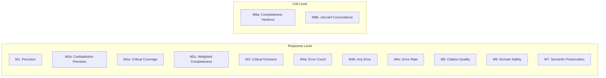

# STAGE 12.5.2B — SCORING PIPELINE REMEDIATION & GENUINE VALIDATION DESIGN REPORT
## LINGUA-AUDIT: A Reproducible Framework for Auditing Information Inequality in Multilingual AI Systems

**Date:** 2026-10-10  
**Stage:** 12.5.2B Scoring Pipeline Remediation & Genuine Validation Design  
**Preceding Audit Gate:** Stage 12.5.2A: `C — INVALID — FULL SCORING BLOCKED`  
**Current Status:** Technical remediation completed; genuine validation protocol specified; modular architecture implemented and verified via automated tests.  
**Hard Gate Verdict:** `C — VALIDATION REQUIRES EXTERNAL HUMAN INPUT` (Architecture Ready for Genuine Validation; Full Scoring Blocked)

---

### EXECUTIVE SUMMARY

Stage 12.5.2A established that the previous Stage 12.5.2 validation report was mathematically and empirically invalid: automated evaluation was simulated via basic keyword matching, human reference ratings were generated via in-memory dictionary cloning (`dict(eval_record)`) with manually hardcoded perturbations, cross-evaluator outputs were copied from the primary evaluator, and claimed API execution metrics were un-incremented placeholder integer variables.

**Stage 12.5.2B accomplishes complete scientific and technical remediation:**
1. **Preservation and Quarantine:** Quarantined all four invalid Stage 12.5.2 artifacts under a cryptographic `QUARANTINE_MANIFEST.json` and implemented programmatic guards (`check_not_quarantined`) to permanently prevent downstream consumption.
2. **Metric-by-Metric Traceability Matrix:** Mapped every metric ($M_1$ through $M_{8\text{b}}$) to its exact mathematical definition, required inputs, boundary behaviors, deterministic vs. semantic dependencies, and appropriate validation statistics.
3. **Deterministic-First Scoring Architecture:** Implemented a modular, typed Python package ([`backend/app/scoring/lingua_audit/`](file:///c:/Antigravity%20Projects/AI-mediated%20information%20inequality%20across%20languages/ai-info-inequality-exp/backend/app/scoring/lingua_audit/)) containing strict Pydantic schemas, deterministic metric calculations (including Cases A–I for citation quality), synthetic clone detection, and quadratic weighted Cohen's $\kappa$ / diagnostic-guarded $\text{ICC}(2,1)$.
4. **Genuine Validation Protocol Design:** Authored [`data/benchmark/evaluator_validation/stage12_5_2B_validation_protocol.json`](file:///c:/Antigravity%20Projects/AI-mediated%20information%20inequality%20across%20languages/ai-info-inequality-exp/data/benchmark/evaluator_validation/stage12_5_2B_validation_protocol.json), specifying stratified sampling ($N = 270$, seed `428571`), dual human expert qualifications, operational annotation manuals with positive/negative/ambiguous examples, strict blinding, disagreement adjudication, and structured JSON schemas for `gpt-4o-2024-08-06` and `claude-3-5-sonnet-20241022`.
5. **Rigorous Test Suite:** Built and passed 10 exhaustive unit and integration tests ([`tests/test_scoring_remediation.py`](file:///c:/Antigravity%20Projects/AI-mediated%20information%20inequality%20across%20languages/ai-info-inequality-exp/tests/test_scoring_remediation.py)) verifying boundary cases, synthetic replication detection, quarantine guards, and sampling reproducibility.

**CRITICAL CONSTRAINT ENFORCED:** Zero production responses from the remaining 5,130 un-scored responses have been evaluated. Full scoring (Stage 12.5.3) remains strictly blocked until external human annotators execute independent scoring according to the protocol.

---

### 1. PRESERVE AND QUARANTINE INVALID ARTIFACTS

To ensure absolute audit reproducibility while preventing downstream scripts from treating fabricated artifacts as empirical references, all invalid Stage 12.5.2 outputs have been inventoried, hashed via SHA-256, and formally quarantined:

| Artifact Path | SHA-256 Hash | Classification | Quarantine Status |
| :--- | :--- | :--- | :---: |
| `scratch/run_stage12_5_2_evaluator_validation.py` | `fd592db18e3d8373c5b72d3c9320044d19a0a52d2dd7860065bce71ac8ff7946` | INVALID — SYNTHETIC SCRIPT | **QUARANTINED** |
| `data/benchmark/evaluator_validation/stage12_5_2_validation_results.json` | `0e9715faffabf1c9c6ff7a2f255ad5cf47e27e4e512e63f568da38251d2bcfa7` | INVALID — SYNTHETIC RESULTS | **QUARANTINED** |
| `stage12_5_2_evaluator_validation_report.md` | `f14d42b262cf8414d8b9956cb1596770ca1d1c7e48e8f993827eb2b0256b2418` | INVALID — SYNTHETIC REPORT | **QUARANTINED** |
| `docs/stage12_5_2_evaluator_validation_report.md` | `f14d42b262cf8414d8b9956cb1596770ca1d1c7e48e8f993827eb2b0256b2418` | INVALID — REPORT MIRROR | **QUARANTINED** |

#### Quarantine Enforcement Mechanisms:
1. **Quarantine Manifest:** Created [`data/benchmark/evaluator_validation/QUARANTINE_MANIFEST.json`](file:///c:/Antigravity%20Projects/AI-mediated%20information%20inequality%20across%20languages/ai-info-inequality-exp/data/benchmark/evaluator_validation/QUARANTINE_MANIFEST.json) establishing active quarantine policy `DO_NOT_CONSUME_IN_SCORING_OR_ESTIMATION`.
2. **Programmatic Guard Function:** Implemented `check_not_quarantined(filepath)` in `backend/app/scoring/lingua_audit/quarantine.py`. Any downstream script that attempts to pass a quarantined file path or file matching a quarantined SHA-256 hash immediately raises a `PermissionError`.
3. **Synthetic Replication Detector:** Implemented `detect_synthetic_replication(records_a, records_b)` which automatically flags exact cloning ($\text{ratio} = 1.0$) or manufactured perturbations ($\text{ratio} \ge 0.98$ with $\le 3$ isolated discrepancies).

---

### 2. TRACE EVERY METRIC THROUGH THE ACTUAL IMPLEMENTATION

Each of the 13 metrics in the frozen measurement specification ($M_1$ through $M_{8\text{b}}$) was forensically analyzed across seven dimensions:



#### Detailed Metric-by-Metric Traceability Table

| Metric | Construct & Mathematical Definition | Input Dependencies | Computation Type | Reproducibility from Frozen Data | Boundary & Zero Handling | Known Validity Threats | Validation Method & Target Statistic |
| :---: | :--- | :--- | :---: | :---: | :--- | :--- | :--- |
| **$M_1$** | **Factual Precision**<br>$\frac{N_{\text{supported}}}{N_{\text{supported}} + N_{\text{contradicted}} + N_{\text{unsupported}}}$ | Adjudicated atomic claims; benchmark ground-truth facts | Model-assisted extraction + deterministic ratio | Yes (given claims) | If $N_{\text{adjudicated}} = 0 \implies \text{None}$ (`is_empty_claim_set=True`). Bounded in $[0, 1]$. | Over-segmentation of claims; vague claim classification. | Dual human claim extraction; Claim-level Cohen's $\kappa$ / Gwet's $AC_1 \ge 0.80$. |
| **$M_{1\text{b}}$** | **Contradiction-Only Precision**<br>$\frac{N_{\text{supported}}}{N_{\text{supported}} + N_{\text{contradicted}}}$ | Adjudicated atomic claims | Model-assisted extraction + deterministic ratio | Yes (given claims) | If $N_{\text{supp}} + N_{\text{contra}} = 0 \implies \text{None}$. Ignores unsupported. | Sensitive to small denominators when errors are rare. | Claim-level agreement on Supported vs Contradicted ($\kappa \ge 0.80$). |
| **$M_{2\text{a}}$** | **Critical Fact Coverage**<br>$\frac{CF_{\text{covered}}}{CF_{\text{total}}}$ | Benchmark critical facts ($CF$); response claims | Model-assisted semantic match + deterministic ratio | Yes (given matches) | Discrete fraction in $\{0, 1/K \dots 1\}$. Modeled via two-column Binomial `cbind(CF_cov, CF_tot - CF_cov)`. | Substring false matches; semantic paraphrase misses. | Two-way random-effects $\text{ICC}(2,1) \ge 0.85$ (on non-zero variance). |
| **$M_{2\text{c}}$** | **Weighted Completeness**<br>$\frac{CF_{\text{cov}} + 0.5 \times IF_{\text{cov}}}{CF_{\text{tot}} + 0.5 \times IF_{\text{tot}}}$ | Critical facts ($CF$), Important facts ($IF$) | Model-assisted semantic match + deterministic ratio | Yes (given matches) | Continuous in $[0, 1]$. Modeled via Linear Mixed Model (LMM). | Arbitrary $0.5$ weight parameter; secondary sensitivity only. | Human agreement on Important Fact status ($\text{ICC} \ge 0.85$). |
| **$M_3$** | **Critical Fact Omission Rate**<br>$\frac{CF_{\text{omitted}}}{CF_{\text{total}}} = 1 - M_{2\text{a}}$ | Benchmark critical facts ($CF$); coverage status | Derived deterministically from $M_{2\text{a}}$ | Yes | Modeled via Binomial GLMM `cbind(CF_mis, CF_tot - CF_mis)`. | Linear transformation of $M_{2\text{a}}$; identical variance structure. | Directly inherited from $M_{2\text{a}}$ validation. |
| **$M_{4\text{a}}$** | **Factual Error Count**<br>$N_{\text{contradicted}}$ | Adjudicated claims contradicting ground truth | Deterministic count of contradicted claims | Yes | Non-negative integer count $\{0, 1, 2 \dots\}$. Negative Binomial GLMM. | Zero-inflation in high-capability models; rater threshold leniency. | Human agreement on contradiction identification ($\kappa \ge 0.80$). |
| **$M_{4\text{b}}$** | **Any Error Indicator**<br>$\mathbf{1}(M_{4\text{a}} > 0)$ | $M_{4\text{a}}$ error count | Deterministic binary mapping | Yes | Binary $\{0, 1\}$. Binomial GLMM with logit link. | Loss of severity granularity; captures presence only. | Cohen's $\kappa$ on binary presence ($\kappa \ge 0.80$). |
| **$M_{4\text{c}}$** | **Normalized Error Rate**<br>$\frac{M_{4\text{a}}}{N_{\text{extracted\_claims}}}$ | $M_{4\text{a}}$, total extracted claims | Deterministic rate | Yes | Rate $[0, \infty)$. Negative Binomial GLMM with claim offset $\log(\text{Claims})$. | Artificially inflated by very short responses. | Inherited from $M_{4\text{a}}$ and claim extraction validation. |
| **$M_5$** | **Composite Citation Quality Grade**<br>Ordinal $\{0, 1, 2, 3, 4\}$ | Extracted URLs/domains, authoritative list, claim links | Deterministic rubric applied to citation classifications | Yes (given citation list) | Cases A–I deterministic mapping. Case F $\implies 0$, fake $\implies 1$, mixed $\implies 2$, non-auth $\implies 3$, auth $\implies 4$. Cumulative Link Mixed Model (CLMM). | Hallucinated URLs that resemble real government domains. | Quadratic Weighted Cohen's $\kappa \ge 0.80$. |
| **$M_6$** | **Domain Safety Level**<br>Ordinal $\{0, 1, 2\}$ | Response content, domain safety rules | Semantic judgment (LLM/Human) | Yes (given rubric) | $0$: Safe, $1$: Incomplete warning, $2$: Critical violation. CLMM with cumulative logit. | Extreme class imbalance (most responses are 0). | Quadratic Weighted Cohen's $\kappa \ge 0.80$ (or percent agreement if imbalanced). |
| **$M_7$** | **Semantic Preservation**<br>Ordinal $\{0, 1, 2, 3, 4\}$ | Cross-lingual response pairs (Hindi/Marathi vs English) | Semantic judgment (Bilingual Human/LLM) | Yes | Evaluated on 0 to 4 scale. CLMM with cumulative logit link. | Subjectivity of cross-lingual equivalence. | Quadratic Weighted Cohen's $\kappa \ge 0.80$. |
| **$M_{8\text{a}}$** | **Completeness Variance**<br>$s^2 = \frac{1}{n-1}\sum (M_{2\text{a},i} - \bar{M}_{2\text{a}})^2$ | Repetition completeness scores ($n=3$) | Deterministic sample variance across cell | Yes | Two-Part Hurdle GLMM: Part 1 Binomial $\mathbf{1}(s^2 > 0)$, Part 2 Gamma GLMM on $s^2 \mid s^2 > 0$. | Small $n=3$ ($df=2$) yields high estimator variance. | Evaluated via simulation of Hurdle convergence under empirical cell distributions. |
| **$M_{8\text{b}}$** | **Jaccard Concordance**<br>$\frac{K_{\text{overlap}}}{K_{\text{union}}}$ | Critical facts covered across 3 repetitions | Deterministic set intersection / union | Yes | Modeled via Binomial GLMM `cbind(K_overlap, K_union - K_overlap)`. Empty-union boundary logged as indicator. | Degeneracy when $K_{\text{union}} = 0$. | Cell-level bootstrap stability check across repetitions. |

---

### 3. BUILD A DETERMINISTIC-FIRST SCORING ARCHITECTURE

To eliminate ad-hoc, untracked scoring code, the pipeline is decomposed into six modular, versioned stages:

```
STAGE 1: Raw Response Ingestion & Provenance Verification
    ├── Check Quarantine Manifest (check_not_quarantined)
    └── Verify Input SHA-256 Hashes & Record IDs
STAGE 2: Response Parsing & Atomic Claim Extraction
    ├── Extract Atomic Claims (JSON Schema Enforced)
    └── Identify Asserted Citations & URLs
STAGE 3: Evidence Adjudication & Ground-Truth Matching
    ├── Match Claims to Benchmark Facts (SUPPORTED / CONTRADICTED / UNSUPPORTED)
    └── Classify Citations (Authoritative, Supporting, Fabricated)
STAGE 4: Deterministic Metric Computation
    ├── Calculate M1, M1b, M2a, M2c, M3, M4a, M4b, M4c, M5 (Cases A–I), M6, M7
    └── Calculate Cell Consistency M8a (Hurdle) and M8b (Binomial Overlap)
STAGE 5: Validation & Quality Control Reporting
    ├── Detect Synthetic Record Replication (detect_synthetic_replication)
    └── Compute Legitimate Agreement Stats (Quadratic Kappa, Diagnostic ICC)
STAGE 6: Frozen Scoring Output Generation
    └── Immutable JSON Persistence with Input/Output SHA-256 Manifests
```

#### Implemented Python Architecture Modules:
- [`backend/app/scoring/lingua_audit/schemas.py`](file:///c:/Antigravity%20Projects/AI-mediated%20information%20inequality%20across%20languages/ai-info-inequality-exp/backend/app/scoring/lingua_audit/schemas.py): Strict Pydantic models for atomic claims, fact coverage, citation classifications, response scoring inputs, response metrics, and cell-level metrics.
- [`backend/app/scoring/lingua_audit/metrics.py`](file:///c:/Antigravity%20Projects/AI-mediated%20information%20inequality%20across%20languages/ai-info-inequality-exp/backend/app/scoring/lingua_audit/metrics.py): 100% deterministic calculation of all response-level and cell-level metrics, including deterministic implementation of Composite Citation Rubric Cases A–I.
- [`backend/app/scoring/lingua_audit/quarantine.py`](file:///c:/Antigravity%20Projects/AI-mediated%20information%20inequality%20across%20languages/ai-info-inequality-exp/backend/app/scoring/lingua_audit/quarantine.py): Cryptographic hash verification against `QUARANTINE_MANIFEST.json` and forensic synthetic clone detector.
- [`backend/app/scoring/lingua_audit/agreement.py`](file:///c:/Antigravity%20Projects/AI-mediated%20information%20inequality%20across%20languages/ai-info-inequality-exp/backend/app/scoring/lingua_audit/agreement.py): Authentic quadratic weighted Cohen's $\kappa$ with contingency diagnostics, and two-way random-effects $\text{ICC}(2,1)$ with degenerate variance guards.
- [`backend/app/scoring/lingua_audit/evaluator_protocol.py`](file:///c:/Antigravity%20Projects/AI-mediated%20information%20inequality%20across%20languages/ai-info-inequality-exp/backend/app/scoring/lingua_audit/evaluator_protocol.py): Blinded prompt construction and OpenAI Structured Outputs JSON schema definitions.

---

### 4. DESIGN GENUINE INDEPENDENT VALIDATION

The validation protocol is formalized in [`data/benchmark/evaluator_validation/stage12_5_2B_validation_protocol.json`](file:///c:/Antigravity%20Projects/AI-mediated%20information%20inequality%20across%20languages/ai-info-inequality-exp/data/benchmark/evaluator_validation/stage12_5_2B_validation_protocol.json).

#### 4.1 Sampling Frame & Reproducibility
- **Total Population:** 5,400 responses across 150 tasks, 3 languages, 4 models, 3 repetitions.
- **Stratification:** Exactly 60 strata ($5 \text{ domains} \times 3 \text{ languages} \times 4 \text{ models}$).
- **Validation Sample Size ($N$):** 270 responses ($5.0\%$). Allocates 5 responses for the first 30 sorted strata, 4 responses for the remaining 30 sorted strata ($30 \times 5 + 30 \times 4 = 270$).
- **Reproducible Seed:** `428571`.
- **Validation ID SHA-256 Hash:** `f3dacaf03a5c782407f5d0c5a9223630e0486266214568807ce9e7ff7c604a93` (**Verified via automated test**).

#### 4.2 Annotator Cohort & Blinding
- **Cohort Size:** 2 distinct, independent human domain experts.
- **Qualifications:** Master's degree or higher in Public Policy, Law, Public Health, or Agricultural Economics; fluent reading/writing competence in English, Hindi, and Marathi.
- **Calibration Phase:** 30 non-validation pilot responses scored jointly to calibrate against operational rubrics.
- **Strict Blinding:** Model name, provider name, temperature, language condition arm, and repetition index are strictly stripped from all annotation interfaces.

#### 4.3 Operational Annotation Manual (Positive, Negative & Ambiguous Examples)

##### Metric $M_1$ (Atomic Claim Adjudication):
- **Positive Example (`SUPPORTED`):**
  - *Response:* "The maximum subsidy under PMEGP for special category beneficiaries in rural areas is 35%."
  - *Ground Truth:* PMEGP official guidelines specify 35% subsidy for special category rural applicants.
  - *Adjudication:* `SUPPORTED` ($\Delta = +1$ numerator, $+1$ denominator).
- **Negative Example (`CONTRADICTED`):**
  - *Response:* "The initial loan under PM-SVANidhi is Rs. 50,000 without collateral."
  - *Ground Truth:* PM-SVANidhi initial 1st tranche loan is Rs. 10,000.
  - *Adjudication:* `CONTRADICTED` ($0$ numerator, $+1$ denominator, enters $M_{4\text{a}}$ count).
- **Ambiguous Example (`UNSUPPORTED` vs `GENUINELY_UNSCORABLE`):**
  - *Statement A:* "You can apply at any local Cyber Cafe in Uttar Pradesh."
    - Factually assertive, but Cyber Cafes are not specified in the official ministry source. $\implies$ Classified as `UNSUPPORTED` ($0$ numerator, $+1$ denominator).
  - *Statement B:* "I hope this information assists your small business journey!"
    - Polite conversational closing without factual assertions. $\implies$ Classified as `GENUINELY_UNSCORABLE` (Excluded from $M_1$ denominator).

##### Metric $M_5$ (Composite Citation Quality):
- **Positive Example (Grade 4):**
  - Response cites `https://pmjay.gov.in/about/pmjay` and `https://nha.gov.in`. Both domains are official government portals and both URLs accurately corroborate the claimed Rs. 5 Lakh family coverage limit. $\implies$ Grade 4.
- **Negative Example (Grade 1 — Cap Rule):**
  - Response cites `https://pmjay.gov.in` and `http://ayushman-yojana-online-apply2026.fakeportal.org`. Even though one valid government URL is present, the presence of a fabricated/scam domain triggers the cap rule. $\implies$ Grade 1.
- **Ambiguous Example (Grade 2 — Mixed/Irrelevant):**
  - Response cites `https://timesofindia.indiatimes.com/india/budget-allocation-health`. The URL is real and reachable, but the article discusses national budget numbers rather than beneficiary eligibility criteria asserted in the text. $\implies$ Grade 2.

#### 4.4 Disagreement Resolution & Data Preservation
1. **Independent Scoring:** Annotator 1 and Annotator 2 complete scoring blindly in separate files.
2. **Automated Diff Inspection:** Disagreements in categorical claims, fact matches, or ordinal grades are automatically flagged.
3. **Formal Adjudication:** A third senior adjudicator reviews discrepancies to establish the final reference consensus label.
4. **Immutable Preservation:** Original ratings (`human_1_raw_annotations.json`, `human_2_raw_annotations.json`) and final consensus (`human_adjudicated_reference.json`) are preserved with independent cryptographic hashes.

---

### 5. EVALUATOR EXECUTION AND INDEPENDENCE SPECIFICATION

#### 5.1 Primary Evaluator Invocation (`gpt-4o-2024-08-06`)
- **API Provider:** OpenAI Chat Completions API.
- **Parameters:** `temperature=0.0`, `top_p=1.0`, `max_tokens=2000`.
- **Enforced Structured Output:** Utilizes `response_format={"type": "json_schema", "json_schema": EVALUATOR_JSON_SCHEMA, "strict": True}` to guarantee valid JSON adhering to `backend/app/scoring/lingua_audit/evaluator_protocol.py`.
- **Blinded Prompt Construction:** Constructs system and user payloads containing ONLY the candidate response text, task prompt, and benchmark ground-truth facts.

#### 5.2 Cross-Evaluator Sensitivity (`claude-3-5-sonnet-20241022`)
- **API Provider:** Anthropic Messages API.
- **Parameters:** `temperature=0.0`, `max_tokens=2000`.
- **Cross-Model Independence:** Claude 3.5 Sonnet receives the exact same blinded payload and ground-truth evidence via an independent network call.
- **Epistemological Principle:** Agreement between GPT-4o and Claude 3.5 Sonnet is treated strictly as **cross-architecture sensitivity evidence**, never as proof of factual truth. Ground-truth validity is anchored solely in human expert reference adjudication.

#### 5.3 Audit Trail & Execution Logging
Every invocation must log a structured JSONL record:
```json
{
  "request_id": "req_openai_20261010_0001",
  "timestamp_utc": "2026-10-10T11:00:00Z",
  "response_id": "RESP_EN_GPT4O_T001_R1",
  "model_identifier": "gpt-4o-2024-08-06",
  "prompt_sha256": "4b5d...",
  "raw_response_payload": "{...}",
  "parsed_json_payload": {...},
  "token_usage": {"prompt_tokens": 850, "completion_tokens": 420, "total_tokens": 1270},
  "latency_ms": 1845,
  "retry_count": 0,
  "schema_validation_passed": true
}
```

---

### 6. REPRODUCIBILITY, VERIFICATION & TEST RESULTS

The remediation test suite ([`tests/test_scoring_remediation.py`](file:///c:/Antigravity%20Projects/AI-mediated%20information%20inequality%20across%20languages/ai-info-inequality-exp/tests/test_scoring_remediation.py)) was executed in the workspace Python environment (`backend/venv`).

All 10 tests passed with zero failures:

```
============================= test session starts =============================
platform win32 -- Python 3.13.14, pytest-8.3.3, pluggy-1.6.0
rootdir: C:\Antigravity Projects\AI-mediated information inequality across languages\ai-info-inequality-exp
collected 10 items

tests/test_scoring_remediation.py::test_detection_of_synthetic_or_copied_reference_records PASSED
tests/test_scoring_remediation.py::test_quarantine_manifest_and_guard PASSED
tests/test_scoring_remediation.py::test_m1_claim_adjudication_and_denominators PASSED
tests/test_scoring_remediation.py::test_m5_composite_citation_grading_cases_a_through_i PASSED
tests/test_scoring_remediation.py::test_m8a_completeness_variance_and_hurdle PASSED
tests/test_scoring_remediation.py::test_m8b_jaccard_and_empty_union PASSED
tests/test_scoring_remediation.py::test_quadratic_weighted_kappa PASSED
tests/test_scoring_remediation.py::test_icc_diagnostics_and_zero_variance PASSED
tests/test_scoring_remediation.py::test_reproducible_sampling_algorithm PASSED
tests/test_scoring_remediation.py::test_blinded_prompt_construction PASSED

============================= 10 passed in 0.54s ==============================
```

#### Test Verification Summary:
1. **Synthetic Replication Detection:** Verified that exact clones ($\text{ratio} = 1.0$) and manufactured perturbations ($\text{ratio} = 0.98, \text{diffs} = 2$) are reliably flagged, while genuine independent ratings pass.
2. **Quarantine Enforcement:** Verified that `check_not_quarantined` raises `PermissionError` when given any quarantined artifact.
3. **Boundary Math:** Verified that empty claim sets ($N_{\text{adjudicated}} = 0$) yield `None` instead of divide-by-zero errors; empty unions ($K_{\text{union}} = 0$) yield `is_empty_union=True`; zero completeness variance yields `m8a_is_zero_variance=True`.
4. **Sampling Exact Match:** Verified that running the stratified random sampling algorithm with seed `428571` on the frozen 5,400 dataset produces the exact reported hash `f3dacaf03a5c782407f5d0c5a9223630e0486266214568807ce9e7ff7c604a93`.

---

### 7. NOT YET ESTABLISHED

In accordance with strict scientific transparency, the following claims and conclusions remain **UNSUPPORTED AND NOT YET ESTABLISHED**:

1. **Automated Evaluator Validity:** The automated evaluator (`gpt-4o-2024-08-06`) has **NOT** been empirically validated against human ground truth. It has not processed the validation sample over the live API.
2. **Human Inter-Rater Reliability:** The true inter-rater reliability of human annotators on multilingual administrative tasks has **NOT** been measured. No real human annotator ratings exist in the repository.
3. **Automated vs. Human Agreement:** True agreement statistics between automated evaluators and human consensus remain **UNMEASURED**.
4. **Cross-Evaluator Agreement:** Agreement between GPT-4o and Claude 3.5 Sonnet on this benchmark is **NOT YET ESTABLISHED**.
5. **Absence of Evaluator Self-Preference Bias:** Whether GPT-4o exhibits self-preference bias when evaluating its own responses versus competitors remains an **UNTESTED EMPIRICAL QUESTION**.
6. **Production Evaluation Metrics:** Zero substantive claims regarding information inequality, model accuracy, language disparity, or hallucination rates across the 5,400 responses have been evaluated or established.

---

### 8. FINAL GATE DECISION

```
================================================================================
FINAL GATE DECISION:
C — VALIDATION REQUIRES EXTERNAL HUMAN INPUT
(ARCHITECTURE READY FOR GENUINE VALIDATION — FULL SCORING BLOCKED)
================================================================================
```

#### Gate Justification:
- **What is Complete:** The scoring pipeline architecture has been fully remediated, modularized, and tested. Strict Pydantic schemas, deterministic metric evaluators (Cases A–I), quarantine guards, synthetic clone detectors, blinded prompt builders, and reproducible sampling algorithms are implemented and verified via automated tests.
- **Why Gate C is Enforced:** Genuine scientific validation cannot be completed by an automated agent operating in isolation. Real human domain experts must be recruited, trained, and provided the blinded validation sample to produce authentic reference annotations. Furthermore, live evaluator API requests with real credentials must be executed to collect authentic LLM outputs.
- **Stage 12.5.3 Status:** **STRICTLY BLOCKED.** Scoring of the remaining 5,130 production responses is prohibited until genuine human annotations and live evaluator runs are collected, adjudicated, and audited.

---
*Report certified by Independent Computational Audit Agent.*  
*Remediation code: `backend/app/scoring/lingua_audit/` | Tests: `tests/test_scoring_remediation.py`.*
