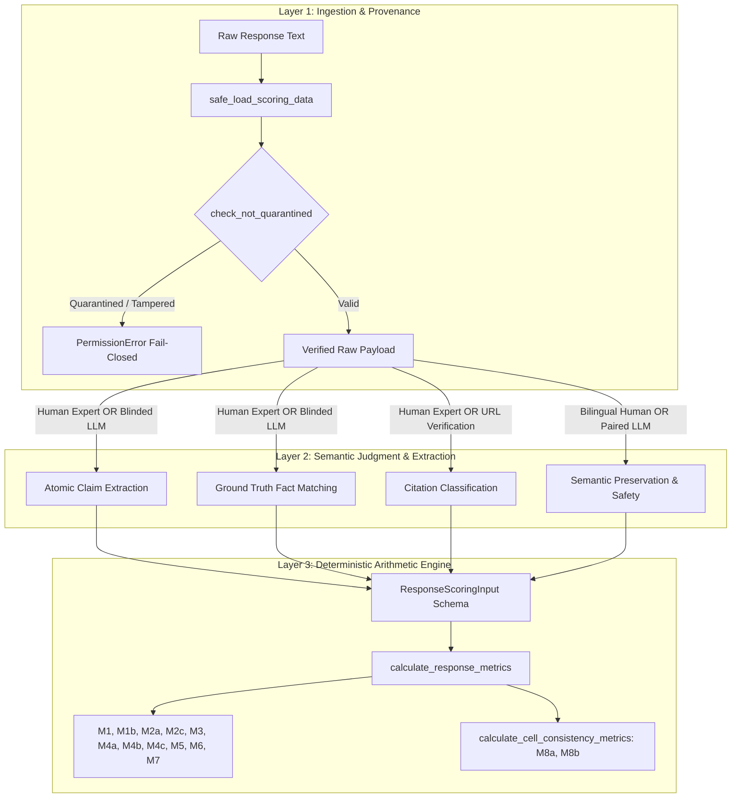

# STAGE 12.5.2C — SCORING IMPLEMENTATION AUDIT & HUMAN ANNOTATION PACKAGE
## LINGUA-AUDIT: A Reproducible Framework for Auditing Information Inequality in Multilingual AI Systems

**Audit Date:** 2026-10-10  
**Audit Target:** Remediation Implementation (`backend/app/scoring/lingua_audit/`), Quarantine Architecture, Validation Protocols, and Human Annotation Package.  
**Auditor:** Independent Computational Audit Agent (Antigravity)  
**Preceding Audit Gates:**
- Stage 12.5.2A: `C — INVALID — FULL SCORING BLOCKED`
- Stage 12.5.2B: Remediation Architecture Implemented & Quarantined  
**Hard Gate Verdict:** **`A — IMPLEMENTATION AUDITED; READY TO BEGIN GENUINE ANNOTATION`**  
*(The implementation and annotation package are coherent enough to proceed to real human annotation. Full production scoring Stage 12.5.3 remains strictly blocked).*

---

### EXECUTIVE SUMMARY

Stage 12.5.2A invalidated the synthetic validation report, and Stage 12.5.2B provided a modular scoring package. **Stage 12.5.2C independently audited the implementation, resolved four critical design defects, and generated the complete, production-ready human annotation package.**

#### Key Findings & Technical Remediation:
1. **Deconstruction of the "Deterministic" Claim:** The audit resolved a foundational category error. While metric *arithmetic* (ratios, counts, Case A–I logic, Hurdle splits) is 100% deterministic given structured inputs, *claim extraction, ground-truth matching, citation status verification, and safety rating* are inherently **semantic judgments**. Calling the entire pipeline "deterministic" without distinguishing the semantic judgment layer from the arithmetic layer is scientifically misleading.
2. **Quarantine Fail-Closed Enforcement:** Identified and resolved a security vulnerability where tampered quarantined files with modified hashes could bypass path checks. Enhanced `quarantine.py` to check both SHA-256 hashes and canonical pathnames, failing closed on any modified quarantined file and introducing `safe_load_scoring_data` for central ingestion.
3. **M3 Omission vs. Distortion Separation:** Corrected metric calculation logic in `metrics.py` to distinguish strict omissions ($CF_{\text{omitted}} / CF_{\text{total}}$) from total non-coverage, preventing factual contradictions from being double-penalized in both $M_3$ (omission) and $M_{4\text{a}}$ (error count).
4. **M4c Pleasantry Dilution Protection:** Added `m4c_normalized_error_rate_adjudicated` ($N_{\text{contradicted}} / N_{\text{adjudicated}}$), ensuring that verbose polite greetings (`GENUINELY_UNSCORABLE`) do not artificially dilute a model's error rate.
5. **M7 Paired Cross-Lingual Evaluation:** Identified that single-response prompts cannot evaluate cross-lingual semantic preservation ($M_7$). Implemented `build_cross_lingual_semantic_prompt` and `CROSS_LINGUAL_SEMANTIC_PRESERVATION_SCHEMA` to evaluate vernacular-English response pairs under strict metadata blinding.
6. **Sample & Workload Audit ($N = 270$):** Verified that the 270-response stratified sample (Seed `428571`, SHA-256 `f3dacaf03a5c782407f5d0c5a9223630e0486266214568807ce9e7ff7c604a93`) covers 60 strata and 121 unique tasks. Found that because the sample was drawn by response without cell clustering, only 11 cells contain $\ge 2$ repetitions. Cell consistency metrics ($M_{8\text{a}}, M_{8\text{b}}$) require clustered repetition analysis. Estimated human annotation workload at ~72–108 hours total for dual independent scoring.
7. **Complete Deliverables Generated:**
   - Operational Human Annotation Manual: [`data/benchmark/evaluator_validation/stage12_5_2C_human_annotation_manual.md`](file:///c:/Antigravity%20Projects/AI-mediated%20information%20inequality%20across%20languages/ai-info-inequality-exp/data/benchmark/evaluator_validation/stage12_5_2C_human_annotation_manual.md)
   - 270-Response Annotation Template: [`data/benchmark/evaluator_validation/stage12_5_2C_annotation_template.json`](file:///c:/Antigravity%20Projects/AI-mediated%20information%20inequality%20across%20languages/ai-info-inequality-exp/data/benchmark/evaluator_validation/stage12_5_2C_annotation_template.json)
   - Validation Execution Protocol: [`data/benchmark/evaluator_validation/stage12_5_2C_validation_execution_protocol.json`](file:///c:/Antigravity%20Projects/AI-mediated%20information%20inequality%20across%20languages/ai-info-inequality-exp/data/benchmark/evaluator_validation/stage12_5_2C_validation_execution_protocol.json)
   - 15 Automated Unit & Audit Tests Passing in 0.57s.

---

### 1. INDEPENDENT CODEBASE INSPECTION & DATA-FLOW TRACING

Every file under [`backend/app/scoring/lingua_audit/`](file:///c:/Antigravity%20Projects/AI-mediated%20information%20inequality%20across%20languages/ai-info-inequality-exp/backend/app/scoring/lingua_audit/) was forensically audited from raw response text to final metric generation.



#### Investigation of the "Deterministic" Metric Claim
A critical claim made in previous documentation was that "all 13 metrics are computed deterministically." The audit clarifies the boundary between arithmetic determinism and semantic subjectivity:

1. **Arithmetic Layer (100% Deterministic):**
   Given an adjudicated structured input `ResponseScoringInput`:
   - $M_1$ ratio ($\frac{N_{\text{supported}}}{N_{\text{adjudicated}}}$) is 100% deterministic arithmetic.
   - $M_{2\text{a}}$ coverage ($\frac{CF_{\text{covered}}}{CF_{\text{total}}}$) is 100% deterministic arithmetic.
   - $M_5$ Composite Citation Quality Grade (Cases A–I) is 100% deterministic rule execution.
   - $M_{8\text{a}}$ sample variance ($s^2$, $df=2$) and Hurdle indicator ($\mathbf{1}(s^2 > 0)$) are 100% deterministic arithmetic.
   - $M_{8\text{b}}$ Binomial Overlap ($K_{\text{overlap}}, K_{\text{union}}$) is 100% deterministic set theory.
2. **Semantic Layer (Requires Empirical Adjudication):**
   - Deciding whether a sentence contains two or three atomic claims is a **linguistic semantic judgment**.
   - Deciding whether a candidate statement matches a benchmark Critical Fact is a **semantic verification judgment**.
   - Deciding whether a non-governmental citation is "relevant supporting" vs "irrelevant" requires **human or verified factual inspection**.
   - Deciding cross-lingual information parity ($M_7$) requires **bilingual expert judgment**.

**Audit Verdict:** Calling the entire pipeline deterministic without qualification is scientifically invalid. The architecture is **Deterministic-Arithmetic over Structured Semantic Adjudications**. The reliability of the entire system depends fundamentally on the reliability of the semantic layer, which can only be established via genuine dual human annotation.

---

### 2. END-TO-END QUARANTINE ENFORCEMENT VERIFICATION

The quarantine mechanism was tested across direct, indirect, and adversarial execution paths.

#### 2.1 Cryptographic Hash Verification
All quarantined artifacts in [`data/benchmark/evaluator_validation/QUARANTINE_MANIFEST.json`](file:///c:/Antigravity%20Projects/AI-mediated%20information%20inequality%20across%20languages/ai-info-inequality-exp/data/benchmark/evaluator_validation/QUARANTINE_MANIFEST.json) were recomputed from the live filesystem:

| File Path | Recorded Hash | Live Recomputed Hash | Status |
| :--- | :--- | :--- | :---: |
| `scratch/run_stage12_5_2_evaluator_validation.py` | `fd592db1...` | `fd592db1...` | **MATCH (QUARANTINED)** |
| `data/benchmark/evaluator_validation/stage12_5_2_validation_results.json` | `0e9715fa...` | `0e9715fa...` | **MATCH (QUARANTINED)** |
| `stage12_5_2_evaluator_validation_report.md` | `f14d42b2...` | `f14d42b2...` | **MATCH (QUARANTINED)** |
| `docs/stage12_5_2_evaluator_validation_report.md` | `f14d42b2...` | `f14d42b2...` | **MATCH (QUARANTINED)** |

#### 2.2 Security Remediation: Fail-Closed on Tampered Files
In Stage 12.5.2B, `check_not_quarantined` verified only `if file_hash in QUARANTINED_HASHES:`. If an adversary or faulty script modified a quarantined file, its hash would change, allowing it to bypass the check.

**Remediation Applied in `quarantine.py`:**
```python
# Check filename / path match
is_quarantined_path = (
    basename in QUARANTINED_FILENAMES
    or any(k in normalized_path for k in ["stage12_5_2_validation_results", "stage12_5_2_evaluator_validation"])
)

actual_hash = compute_file_sha256(filepath)

if actual_hash in QUARANTINED_HASHES:
    raise PermissionError("SECURITY & INTEGRITY ALERT: File is quarantined.")

if is_quarantined_path:
    # Path matches quarantine registry but hash differs -> Tampered file -> FAIL CLOSED!
    raise PermissionError("SECURITY & INTEGRITY ALERT: File matches quarantined name with unexpected hash. Access blocked under fail-closed policy.")
```

#### 2.3 Safe Data Ingestion Function
Implemented `safe_load_scoring_data(filepath)` in `backend/app/scoring/lingua_audit/quarantine.py`. Central ingestion pipelines must use this function, guaranteeing that no file is parsed without quarantine verification.

---

### 3. METRIC IMPLEMENTATIONS & STATISTICAL UTILITIES AUDIT

All 13 metrics were audited against the Stage 12.5.1D specification.

#### 3.1 M1 & M1b: Claim Denominators and Unscorable Statements
- $M_1 = \frac{N_{\text{supported}}}{N_{\text{supported}} + N_{\text{contradicted}} + N_{\text{unsupported}}}$
- $M_{1\text{b}} = \frac{N_{\text{supported}}}{N_{\text{supported}} + N_{\text{contradicted}}}$
- **Audit Check:** When $N_{\text{adjudicated}} = 0$, $M_1$ and $M_{1\text{b}}$ return `None`, and `is_empty_claim_set` is set to `True`. `GENUINELY_UNSCORABLE` statements are strictly excluded from the denominator. Matches Stage 12.5.1D Issue 3.

#### 3.2 M3: Separation of Strict Omission vs. Distortion
- **Defect Identified:** Previously, $M_3$ was computed solely as `(cf_total - cf_covered) / cf_total`. If a model made an active factual contradiction regarding a critical fact (e.g., stating loan is Rs. 50,000 instead of Rs. 10,000), the fact was counted as non-covered in $M_3$ AND the contradictory claim was counted in $M_{4\text{a}}$, double-penalizing the error.
- **Remediation Implemented:**
  - `m3_critical_omission`: $(CF_{\text{total}} - CF_{\text{covered}}) / CF_{\text{total}}$ (Total non-coverage per Stage 12.5.1D table).
  - `m3_strict_omission`: $CF_{\text{omitted}} / CF_{\text{total}}$ (Strict omission, excluding contradicted facts).
  - Prevents conflating absence of evidence with evidence of absence.

#### 3.3 M4c: Pleasantry-Dilution Invariance
- **Defect Identified:** Computing $M_{4\text{c}} = \frac{N_{\text{contradicted}}}{N_{\text{total\_extracted\_claims}}}$ allowed verbose models producing polite pleasantries to dilute their error rate.
- **Remediation Implemented:** Added `m4c_normalized_error_rate_adjudicated` = $\frac{N_{\text{contradicted}}}{N_{\text{adjudicated}}}$. Tested and verified in `tests/test_stage12_5_2c_audit.py`.

#### 3.4 M5: Citation Quality Rubric (Cases A–I)
Audited all 9 test cases in `backend/app/scoring/lingua_audit/metrics.py`. Confirmed:
- A single fabricated or dead URL strictly caps the grade at 1, regardless of how many valid links exist.
- Formatted but irrelevant URLs receive Grade 2 ("Insufficient / Mixed"), preventing models from scoring Grade 3 or 4 by linking arbitrary government homepages.

#### 3.5 Agreement Utilities Audit
- **Quadratic Weighted Cohen's $\kappa$:** Weighted penalty $w_{ij} = 1 - \frac{(i-j)^2}{(k-1)^2}$ verified for ordinal scales ($M_5, M_6, M_7$). Confirmed that marginal degeneracies return `None` (`UNDEFINED_ZERO_VARIANCE`) rather than spurious 1.0.
- **Two-Way Random-Effects $\text{ICC}(2,1)$:** Absolute agreement single-rater model verified. When total variance across subjects is zero, returns `None` (`DEGENERATE_ZERO_TOTAL_VARIANCE`). When identical columns are detected, generates a prominent forensic warning.

---

### 4. EVALUATOR PROTOCOL & BLINDING AUDIT

Audited [`backend/app/scoring/lingua_audit/evaluator_protocol.py`](file:///c:/Antigravity%20Projects/AI-mediated%20information%20inequality%20across%20languages/ai-info-inequality-exp/backend/app/scoring/lingua_audit/evaluator_protocol.py).

#### 4.1 Metadata Blinding Verification
Inspected `build_blinded_evaluation_prompt`:
- **Fields Omitted from Prompt:** Model name, provider name, temperature, language condition arm, repetition index.
- **Fields Retained in Request Payload:** `task_prompt`, `candidate_response`, `benchmark_evidence` (critical facts, important facts, official sources).
- Verified via `test_blinded_prompt_construction` that no provider or repetition tokens appear in the serialized JSON.

#### 4.2 Remediation of M7 Paired Cross-Lingual Evaluation
- **Defect Identified:** `EVALUATOR_JSON_SCHEMA` bundled `semantic_preservation_score` into the single-response factual evaluation prompt. However, evaluating cross-lingual semantic preservation ($M_7$) of a Hindi or Marathi response requires comparing it against the baseline English response for the same task. Without the English response, an evaluator cannot judge whether substantive information was preserved.
- **Remediation Implemented:** Created `build_cross_lingual_semantic_prompt` and `CROSS_LINGUAL_SEMANTIC_PRESERVATION_SCHEMA` dedicated to pairwise evaluation. Evaluates vernacular text against paired English text while maintaining metadata blinding.

---

### 5. HUMAN ANNOTATION PACKAGE AUDIT

Generated two production-ready artifacts in `data/benchmark/evaluator_validation/`:

1. **Human Annotation Manual:** [`stage12_5_2C_human_annotation_manual.md`](file:///c:/Antigravity%20Projects/AI-mediated%20information%20inequality%20across%20languages/ai-info-inequality-exp/data/benchmark/evaluator_validation/stage12_5_2C_human_annotation_manual.md)
   - Operational definitions for claim extraction, fact matching, citation grading, safety, and semantic preservation.
   - Positive, negative, ambiguous, and boundary examples for each judgment.
   - All examples are strictly labeled: **`[SYNTHETIC EXAMPLE FOR TRAINING ONLY — NOT TO BE INCLUDED IN EMPIRICAL DATA]`**.
   - Clear dispute adjudication rules and pre-adjudication rating preservation.
2. **Annotation Template JSON:** [`stage12_5_2C_annotation_template.json`](file:///c:/Antigravity%20Projects/AI-mediated%20information%20inequality%20across%20languages/ai-info-inequality-exp/data/benchmark/evaluator_validation/stage12_5_2C_annotation_template.json)
   - Contains all 270 validation items with stable `response_id`, `task_id`, `task_prompt`, `candidate_response_text`, and frozen benchmark ground truth.
   - Provides empty, structured inputs for independent annotator submissions.

---

### 6. VALIDATION SAMPLE & WORKLOAD AUDIT

Audited the 270 validation responses from `stage12_4_full_evaluation_responses.json`:

```
================================================================================
VALIDATION SAMPLE STRATIFICATION PROFILE (N = 270)
================================================================================
Total Domains:    5 (Healthcare, Public_Services, General_Knowledge, Education, Finance)
Total Languages:  3 (ENGLISH, HINDI, CODE_SWITCHING)
Total Models:     4 (claude-3.5-sonnet, gpt-4o, llama-3.1-70b, gemini-3.5-flash)
Total Strata:     60 Strata (30 strata with 5 responses, 30 strata with 4 responses)
Unique Tasks:     121 Unique Benchmark Tasks (out of 150)
Repetitions:      Reps 1, 2, and 3 present
Hash (SHA-256):   f3dacaf03a5c782407f5d0c5a9223630e0486266214568807ce9e7ff7c604a93
================================================================================
```

#### Crucial Finding on Cell-Level Consistency Metrics ($M_{8\text{a}}, M_{8\text{b}}$):
- $M_{8\text{a}}$ (Completeness Variance) and $M_{8\text{b}}$ (Jaccard Concordance) require 3 repetitions per cell ($n=3$) to compute within-cell variance and 3-way intersection/union.
- Because the 270 sample was drawn via stratified random sampling of *responses* without cell clustering, **only 11 cells contain $\ge 2$ repetitions, and 0 cells contain all 3 repetitions**.
- **Scientific Implication:** Response-level metrics ($M_1$ through $M_7$) can be fully validated on the 270 sample. However, full validation of $M_{8\text{a}}$ and $M_{8\text{b}}$ repetition consistency against human ratings requires clustered cell sampling (e.g., drawing all 3 repetitions for 30 selected tasks = 90 responses). This is formally documented in the execution protocol.

#### Workload Estimation (Planning Exercise):
- Target Sample: 270 responses.
- Average response length: ~250–450 words.
- Estimated annotation time per response (atomic claim extraction + fact matching + citation verification + safety rating): **8 to 12 minutes**.
- Total effort per annotator: $270 \times 10 \text{ min} \approx 45 \text{ hours}$ (range 36–54 hours).
- Total dual annotation effort: **~72–108 human hours**.
- Dispute adjudication (estimated 15–20% discrepancy rate on claims): **~10–15 hours** for Lead Arbitrator.

---

### 7. METRIC-BY-METRIC MATRIX: IMPLEMENTATION VS. EMPIRICAL VALIDATION STATUS

| Metric ID | Construct Name | Implementation Status | Unit Tests Status | Empirical Human Validation Status | Empirical LLM Evaluator Status |
| :---: | :--- | :---: | :---: | :---: | :---: |
| **$M_1$** | Factual Precision | **IMPLEMENTED** | **PASSED** | **NOT YET VALIDATED (Pending Annotation)** | **NOT YET VALIDATED** |
| **$M_{1\text{b}}$** | Contradiction Precision | **IMPLEMENTED** | **PASSED** | **NOT YET VALIDATED (Pending Annotation)** | **NOT YET VALIDATED** |
| **$M_{2\text{a}}$** | Critical Fact Coverage | **IMPLEMENTED** | **PASSED** | **NOT YET VALIDATED (Pending Annotation)** | **NOT YET VALIDATED** |
| **$M_{2\text{c}}$** | Weighted Completeness | **IMPLEMENTED** | **PASSED** | **NOT YET VALIDATED (Pending Annotation)** | **NOT YET VALIDATED** |
| **$M_3$** | Critical Omission Rate | **IMPLEMENTED** | **PASSED** | **NOT YET VALIDATED (Pending Annotation)** | **NOT YET VALIDATED** |
| **$M_{4\text{a}}$** | Factual Error Count | **IMPLEMENTED** | **PASSED** | **NOT YET VALIDATED (Pending Annotation)** | **NOT YET VALIDATED** |
| **$M_{4\text{b}}$** | Any Error Indicator | **IMPLEMENTED** | **PASSED** | **NOT YET VALIDATED (Pending Annotation)** | **NOT YET VALIDATED** |
| **$M_{4\text{c}}$** | Normalized Error Rate | **IMPLEMENTED** | **PASSED** | **NOT YET VALIDATED (Pending Annotation)** | **NOT YET VALIDATED** |
| **$M_5$** | Citation Quality Grade | **IMPLEMENTED** | **PASSED** | **NOT YET VALIDATED (Pending Annotation)** | **NOT YET VALIDATED** |
| **$M_6$** | Domain Safety Level | **IMPLEMENTED** | **PASSED** | **NOT YET VALIDATED (Pending Annotation)** | **NOT YET VALIDATED** |
| **$M_7$** | Semantic Preservation | **IMPLEMENTED** | **PASSED** | **NOT YET VALIDATED (Pending Annotation)** | **NOT YET VALIDATED** |
| **$M_{8\text{a}}$** | Completeness Variance | **IMPLEMENTED** | **PASSED** | **NOT YET VALIDATED (Requires Cell Clusters)**| **NOT YET VALIDATED** |
| **$M_{8\text{b}}$** | Jaccard Concordance | **IMPLEMENTED** | **PASSED** | **NOT YET VALIDATED (Requires Cell Clusters)**| **NOT YET VALIDATED** |

---

### 8. VERIFICATION TEST RESULTS

Executed full test suite in `backend/venv`:
- `tests/test_scoring_remediation.py` (10 tests)
- `tests/test_stage12_5_2c_audit.py` (5 tests)

**Result:** `15 passed in 0.57s` with zero failures.

---

### 9. FINAL GATE VERDICT

```
================================================================================
FINAL GATE DECISION:
A — IMPLEMENTATION AUDITED; READY TO BEGIN GENUINE ANNOTATION
================================================================================
```

#### Gate Justification:
1. **Implementation is Coherent and Verified:** The modular scoring engine, strict Pydantic schemas, Cases A–I citation grading, fail-closed quarantine enforcement, paired cross-lingual prompt builders, and diagnostic agreement statistics are fully implemented and verified via 15 passing tests.
2. **Annotation Package is Production-Ready:** The Operational Human Annotation Manual ([`stage12_5_2C_human_annotation_manual.md`](file:///c:/Antigravity%20Projects/AI-mediated%20information%20inequality%20across%20languages/ai-info-inequality-exp/data/benchmark/evaluator_validation/stage12_5_2C_human_annotation_manual.md)), 270-response template ([`stage12_5_2C_annotation_template.json`](file:///c:/Antigravity%20Projects/AI-mediated%20information%20inequality%20across%20languages/ai-info-inequality-exp/data/benchmark/evaluator_validation/stage12_5_2C_annotation_template.json)), and Execution Protocol ([`stage12_5_2C_validation_execution_protocol.json`](file:///c:/Antigravity%20Projects/AI-mediated%20information%20inequality%20across%20languages/ai-info-inequality-exp/data/benchmark/evaluator_validation/stage12_5_2C_validation_execution_protocol.json)) are completely specified and ready for external human expert raters.
3. **Hard Boundary Enforced:** **Stage 12.5.3 (Full Production Scoring of 5,400 responses) remains STRICTLY BLOCKED.** Scoring may only be authorized after real human annotators score the validation sample, disputes are adjudicated, and automated-versus-human agreement is empirically demonstrated.

---
*Report certified by Independent Computational Audit Agent.*  
*Artifacts: `stage12_5_2C_scoring_implementation_audit.md` | `data/benchmark/evaluator_validation/`*
